# ENCS4380 Homework 1: Dynamic Characteristics Interactive Toolkit

An interactive engineering toolkit for studying the dynamic characteristics of measurement systems through mathematical modeling, real-time simulation, and visual analysis.

**Course:** ENCS4380 – Interfacing Techniques  
**University:** Birzeit University  
**Instructor:** Dr. Wasel Ghanem  
**Released:** Thursday, 29 October 2026  
**Due:** Thursday, 12 November 2026

## Live Application

**[Launch the Dynamic Characteristics Toolkit](https://amjad-adi.github.io/encs4380-dynamics-Remy/)**

**Source Code:** [GitHub Repository](https://github.com/Amjad-Adi/encs4380-dynamics-Remy)

---

## Team and Contributions

The project is developed collaboratively, with each team member responsible for a dedicated module and its integration into the overall toolkit.

| Team Member | Module   | Responsibility                 |
| ----------- | -------- | ------------------------------ |
| Amjad Adi   | Module 1 | First-Order Time Response      |
| Yazeed      | Module 2 | First-Order Frequency Response |
| Hanan       | Module 3 | Second-Order System Response   |
| Rahaf       | Module 4 | Guess the Sensor Challenge     |

---

## Project Modules

The application is organized into four interconnected modules, progressing from fundamental first-order system behavior to second-order dynamics and practical sensor identification. It also includes the standalone Bonus Numerical ODE Solver described below.

### Module 1 - First-Order Time Response

**Developer: Amjad Adi**

An interactive investigation of first-order measurement systems in the time domain, based on the transfer function:

\[
G(s)=\frac{K}{\tau s+1}
\]

The module provides adjustable gain and time-constant parameters, with selectable step and ramp inputs. Its visualizations connect the mathematical model to the transient and steady-state behavior of a measurement system.

**Implemented features:**

- Interactive first-order step-response simulation.
- Dynamic visualization of the 63.2% response point at \(t=\tau\) and the 95% response point at \(t=3\tau\).
- Ramp-response simulation with ideal and actual output comparison.
- Calculation and visualization of ramp tracking lag and steady-state error.
- Logarithmic error-fraction analysis demonstrating the relationship between response decay and the time constant.
- Interactive parameter controls and dynamically updated plots.

**Screenshots**

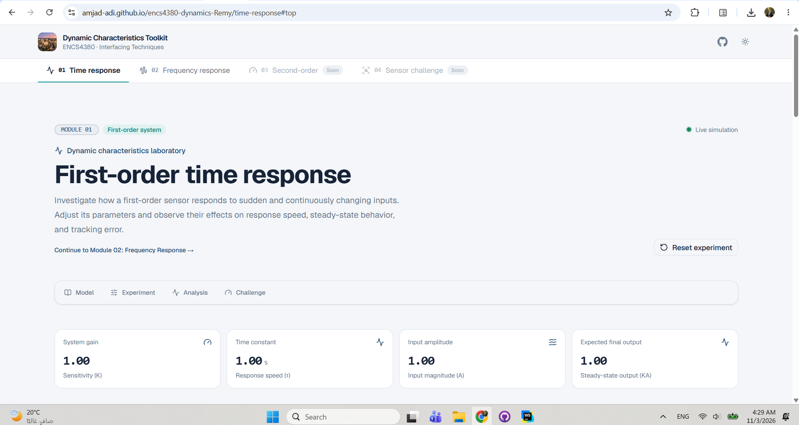

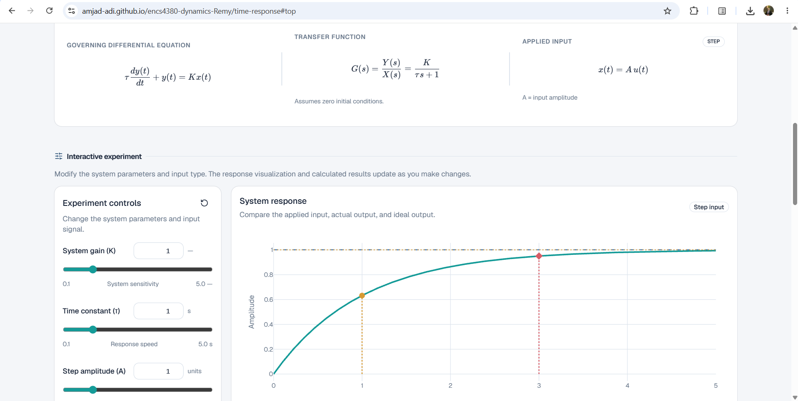

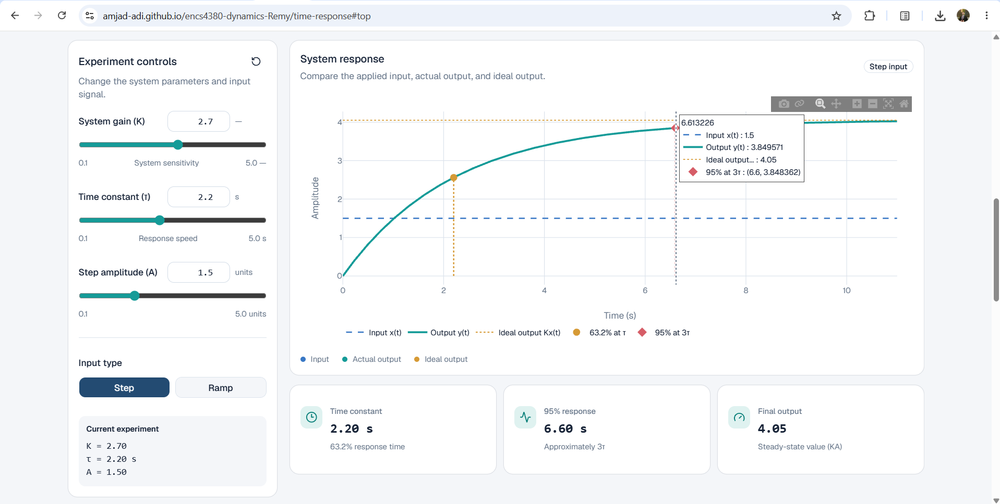

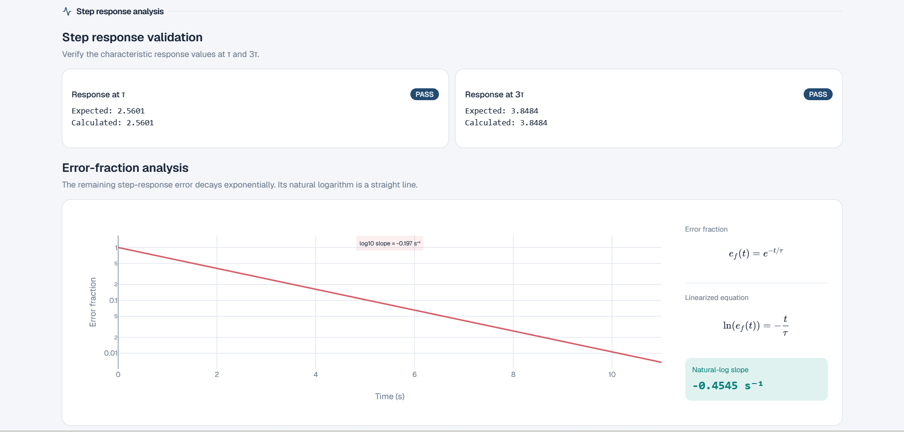

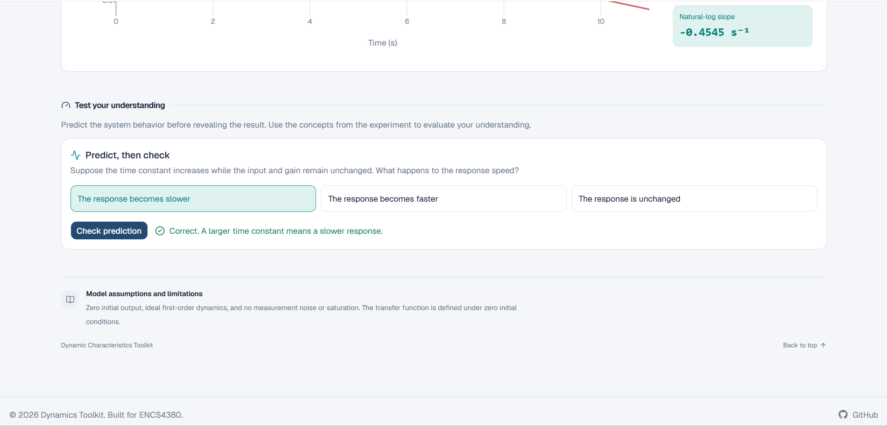

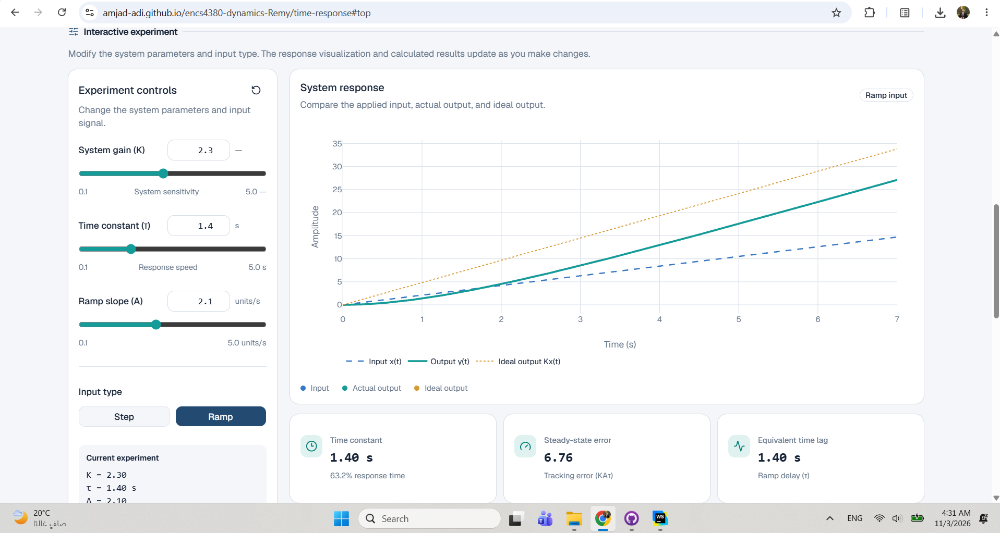

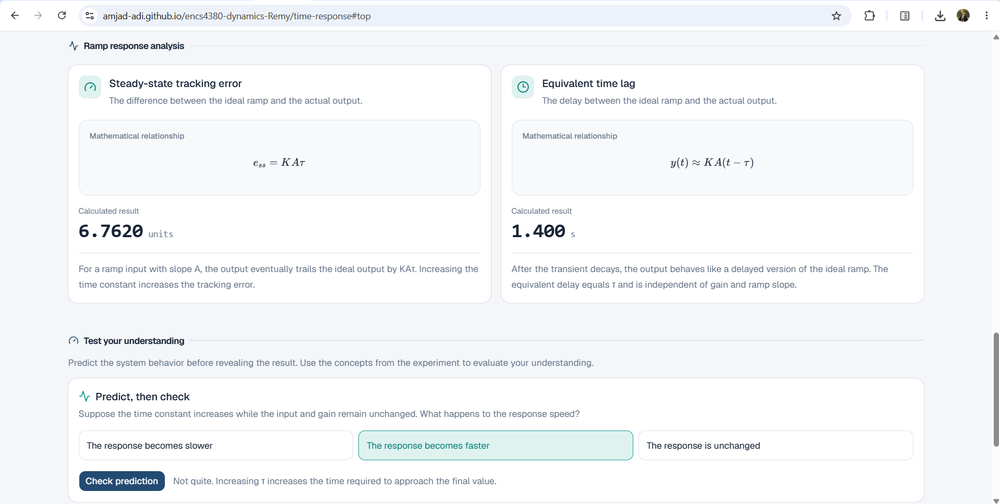

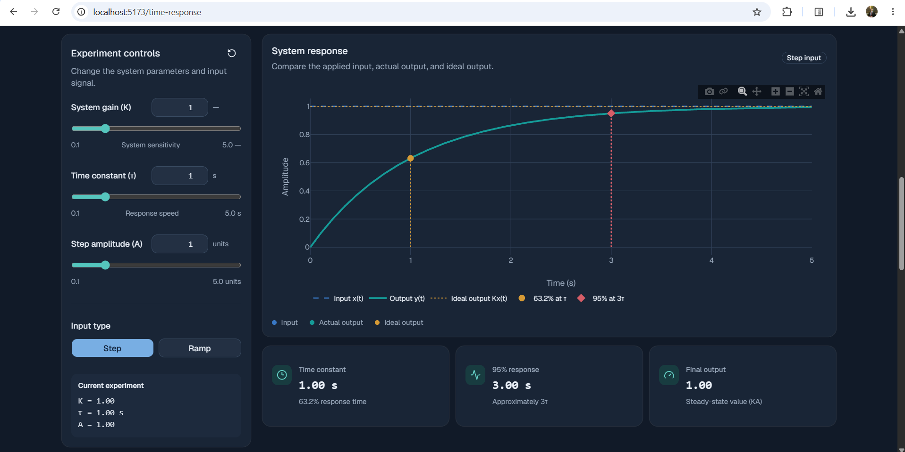

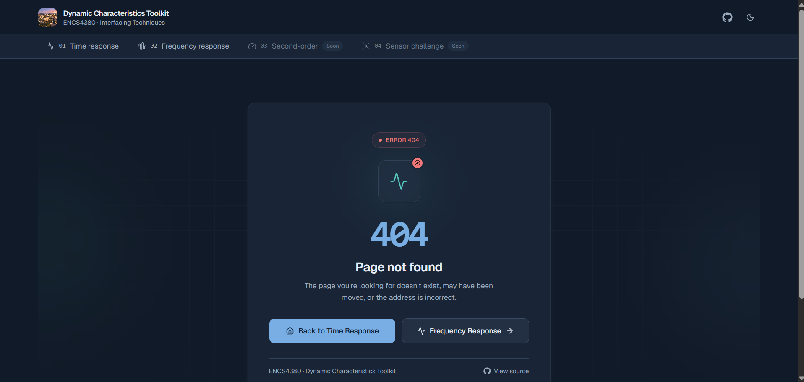

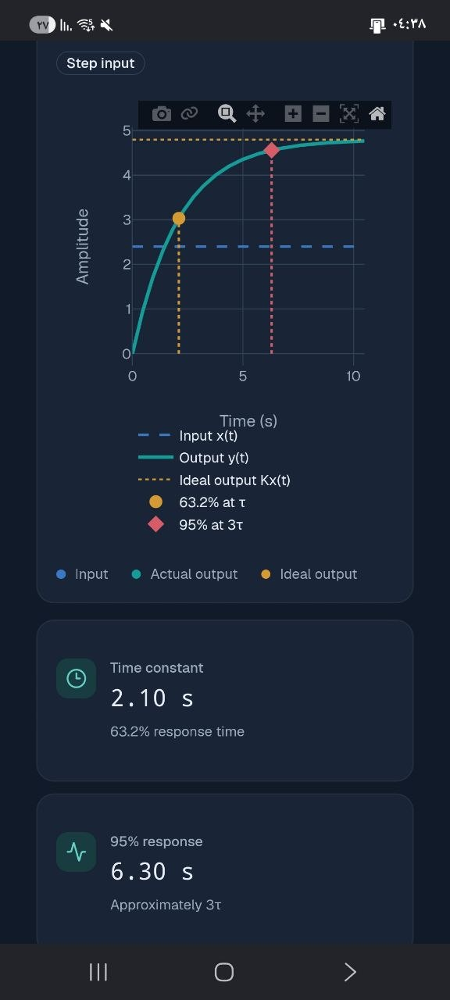

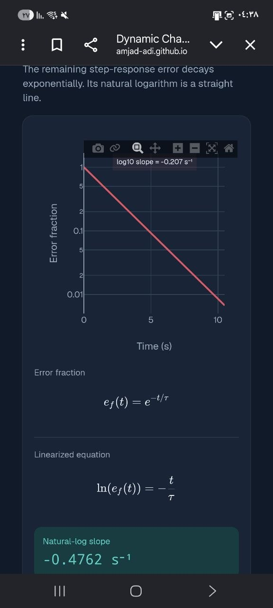

### Module 2 - First-Order Frequency Response

**Developer: Yazeed**

An interactive analysis of first-order measurement systems in the frequency domain, examining how a sensor responds to sinusoidal inputs across different operating frequencies.

The module connects the frequency-domain transfer function to observable changes in output amplitude and phase:

\[
M=\frac{1}{\sqrt{1+(\omega\tau)^2}},
\qquad
\phi=-\tan^{-1}(\omega\tau)
\]

**Implemented features:**

- Interactive sinusoidal input and output visualization.
- Real-time amplitude-ratio and phase-lag calculations.
- Frequency-response analysis with adjustable time constant and input frequency.
- Bode magnitude and phase plots.
- Cutoff-frequency identification at \(\omega_c=1/\tau\).
- Dynamic-error calculation using \(\delta=M-1\).
- Parameter-dependent visualizations and numerical results.

**Screenshots**

**Screenshots**

### Module 3 - Second-Order System Response

**Developer: Hanan**

An interactive study of second-order measurement systems, focusing on the influence of damping ratio and natural frequency on transient response.

The module brings together time-domain response analysis and pole-based system interpretation, using the standard second-order transfer function:

$$
G(s)=\frac{K\omega_n^2}{s^2+2\zeta\omega_n s+\omega_n^2}
$$

**Implemented features:**

- Interactive underdamped, critically damped, and overdamped response simulations.
- Adjustable damping ratio and natural frequency.
- Live rise-time, peak-time, percentage-overshoot, and settling-time measurements.
- Pole visualization in the complex s-plane.
- Mass-spring-damper state-space representation.
- Live state-space matrix updates based on mass, damping, and stiffness.
- Eigenvalue calculations and comparison with the system poles.
- Phase-plane visualization of displacement and velocity trajectories.

**Screenshots**
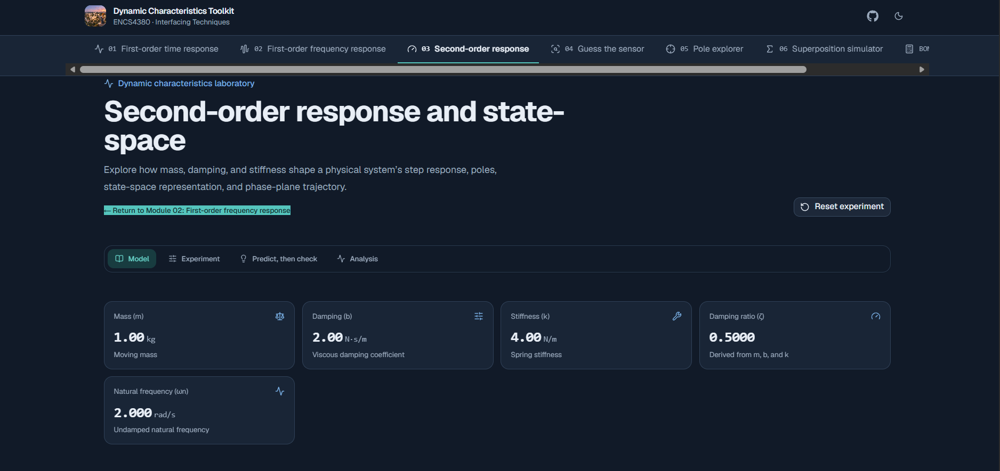

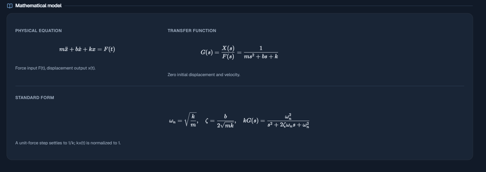

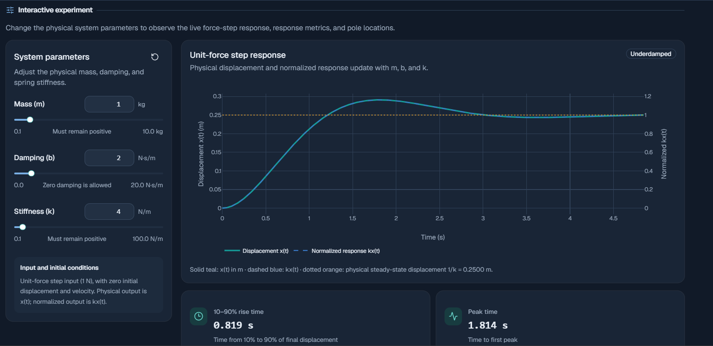

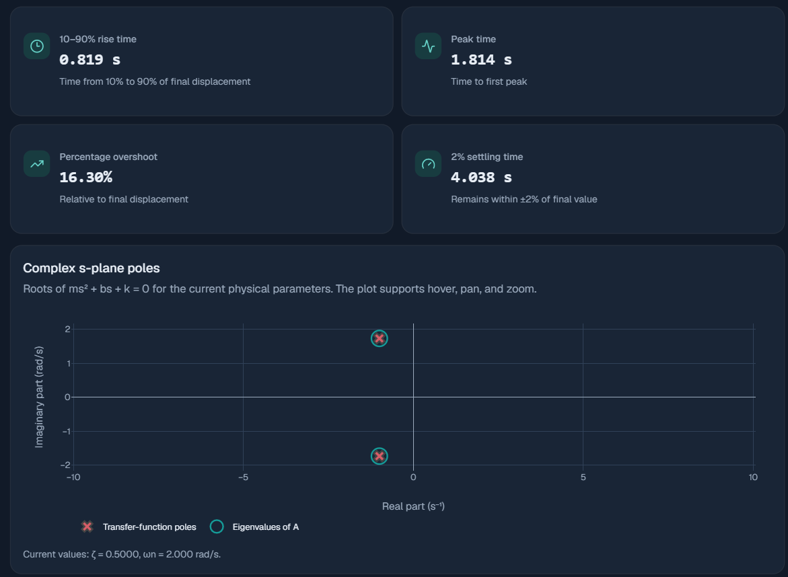

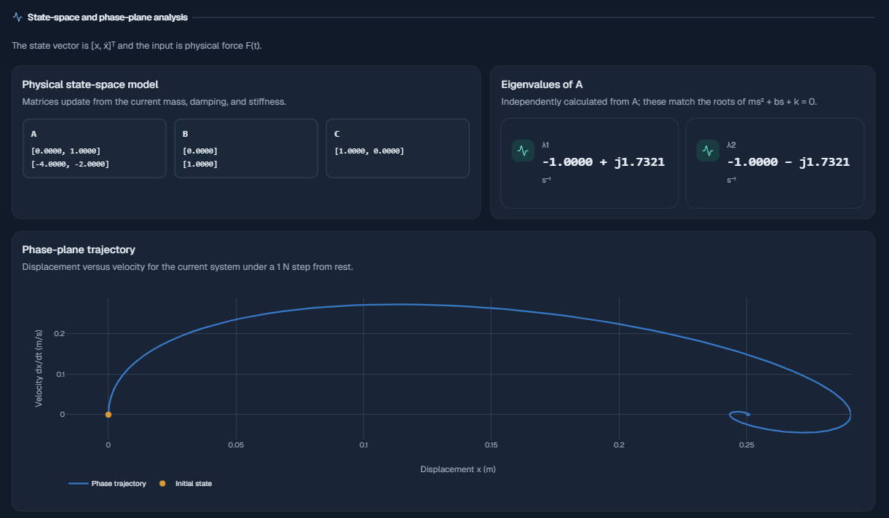

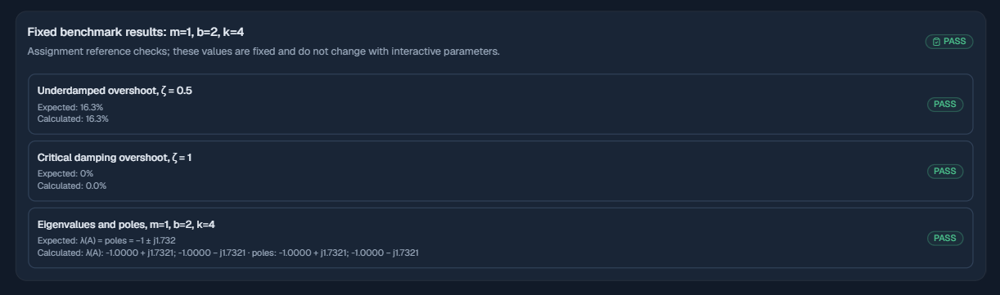

### Module 4 - Guess the Sensor Challenge

**Developer: Rahaf**

An interactive parameter-estimation challenge that puts the concepts from the preceding modules into practice. Users investigate an unknown sensor response and estimate its underlying dynamic parameters from the observed behavior.

**Implemented features:**

- Random generation of first-order and second-order sensor models.
- Noisy response visualization.
- Parameter estimation using response characteristics.
- First-order estimation through the time constant and error-decay behavior.
- Second-order estimation through overshoot and peak time.
- Comparison of estimated and actual system responses.
- Parameter-recovery scoring and session score tracking.
- New-sensor generation and contextual hints.

**Screenshots**

### 09 - Slow Sensor in the Feedback Loop

**Owner:** Hanan Yousef Mohammed Alawawda

09 investigates how a first-order sensor lag inside a feedback loop changes
closed-loop PID behavior. The student compares the true plant output with the
delayed measured sensor output while changing the sensor time constant and PID
gains.

The module supports both first-order and second-order plants. Its sensor model
is:

$$
H_s(s)=\frac{1}{\tau_s s+1},
\qquad
\tau_s\frac{dy_m}{dt}=y-y_m
$$

The controller uses the measured output:

$$
e(t)=r(t)-y_m(t)
$$

and the controller signal is limited before it is applied to the plant. The
plant and sensor states are integrated together with fourth-order Runge–Kutta
(RK4). The interactive module includes:

- Sensor time-constant and PID gain controls with safe validation.
- True plant, measured sensor, and setpoint response plots on a shared time axis.
- Minimum and maximum controller-output limits.
- Performance analysis for peak output, direction-aware overshoot, and the
  final true/measured output difference.
- A Predict-then-Check activity covering sensor lag, overshoot, and oscillation.
  Oscillation feedback compares peak-to-peak amplitude and reports insufficient
  data when too few extrema are available.
- Responsive desktop and mobile navigation.

The final true/measured output difference is a sensor-lag measure at the final
sample; it is not the steady-state tracking error. Increasing $\tau_s$ does
not universally increase overshoot or oscillation, so the prediction activity
evaluates the current simulation parameters rather than assuming a fixed trend.

**Screenshots**

**First-order response**

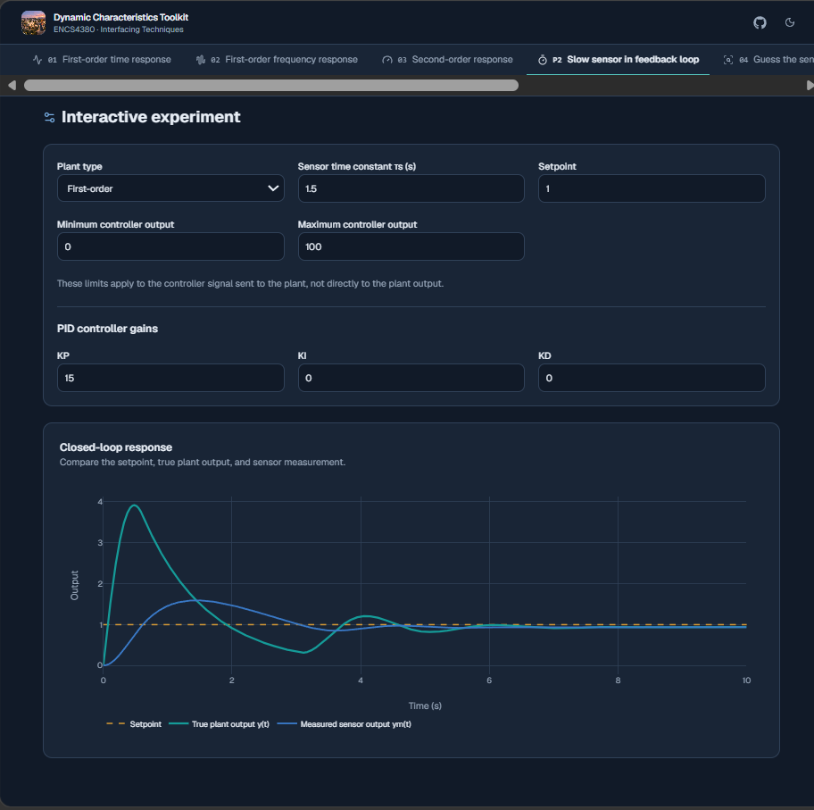

**Second-order response**

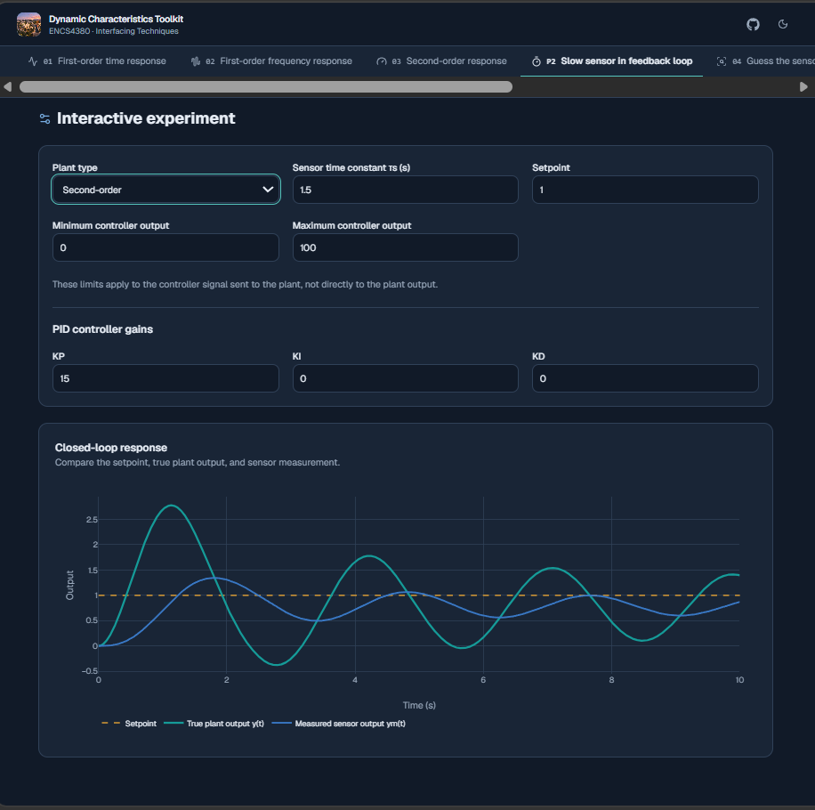

**Performance analysis**

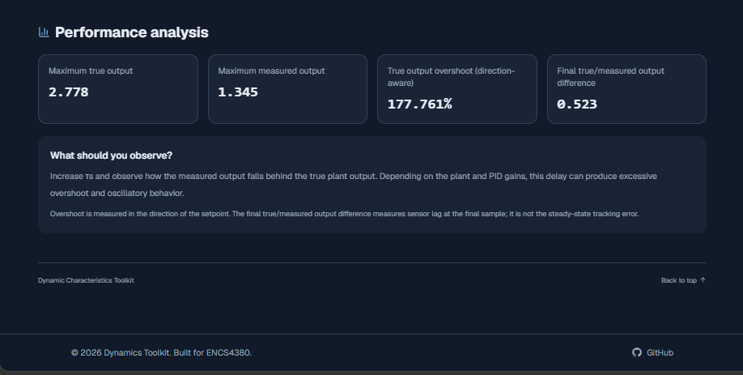

**Predict-then-Check before checking**

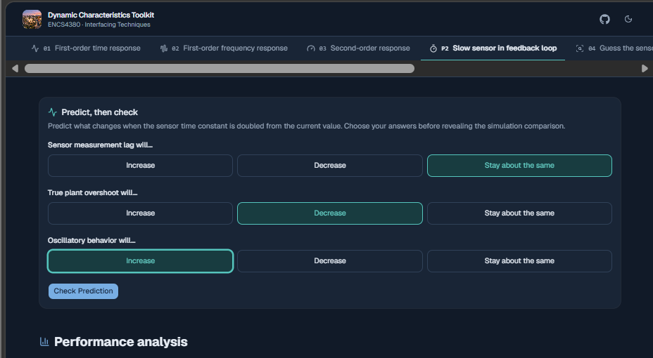

**Predict-then-Check after checking**

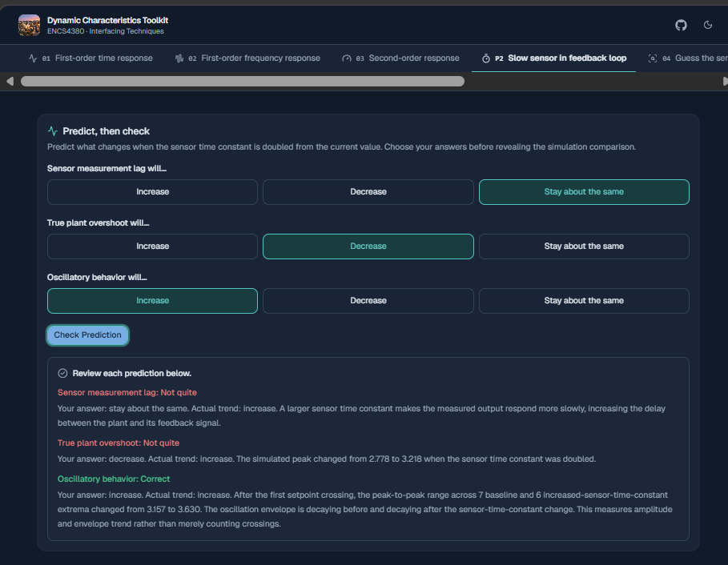

### Bonus — Numerical ODE Solver

The standalone Bonus tool compares numerical integration of a first-order system with its analytical step response. For a system with transfer function

$$
G(s)=\frac{K}{\tau s+1}
$$

and a step input of amplitude \(A\), the zero-initial-condition model is

$$
\tau\frac{dy}{dt}+y=KA,\qquad y(0)=0
$$

Its analytical response, used as the reference for the numerical errors, is

$$
y(t)=KA\left(1-e^{-t/\tau}\right)
$$

The live experiment integrates the differential equation from \(t=0\), displaying the analytical response and both numerical approximations at shared time points:

- **Euler's method** advances the output by

$$
y_{n+1} = y_n + \Delta t \cdot f(t_n, y_n)
$$

where

$$
f(t,y) = \frac{KA-y}{\tau}
$$

- **Fourth-order Runge–Kutta (RK4)** combines four derivative evaluations per step (at the start, two midpoint estimates, and the end) in a weighted average. It is generally more accurate than Euler for the tested step sizes.

The controls adjust:

| Parameter           | Meaning                                                                                                            |
| ------------------- | ------------------------------------------------------------------------------------------------------------------ |
| \(K\)               | System gain                                                                                                        |
| \(\tau\)            | System time constant, in seconds                                                                                   |
| \(A\)               | Step-input amplitude                                                                                               |
| \(\Delta t\)        | Integration step size, in seconds; the final step is shortened if needed to end exactly at the simulation duration |
| Simulation duration | End time of the integration, in seconds                                                                            |

Error metrics compare each numerical result with the analytical response at every shared sampled time:

- **Maximum absolute error:** the largest absolute difference across the sampled points.
- **Root mean square error (RMSE):** the square root of the mean of squared differences across the sampled points.
- **Final-time absolute error:** the absolute difference at the simulation endpoint.

Euler stability is classified using \(r=\Delta t/\tau\) and its amplification factor \(1-r\): \(0<r\leq1\) is stable without alternating error; \(1<r<2\) is stable with damped oscillation; \(r=2\) is marginally stable with persistent alternating error; and \(r>2\) is unstable, with errors growing from step to step. These classifications describe Euler stability, not the size of ordinary approximation error.

**Screenshots**

The following captures show the running local application: parameter controls, the comparison chart, error metrics, the prediction exercise, and a narrow-screen layout.

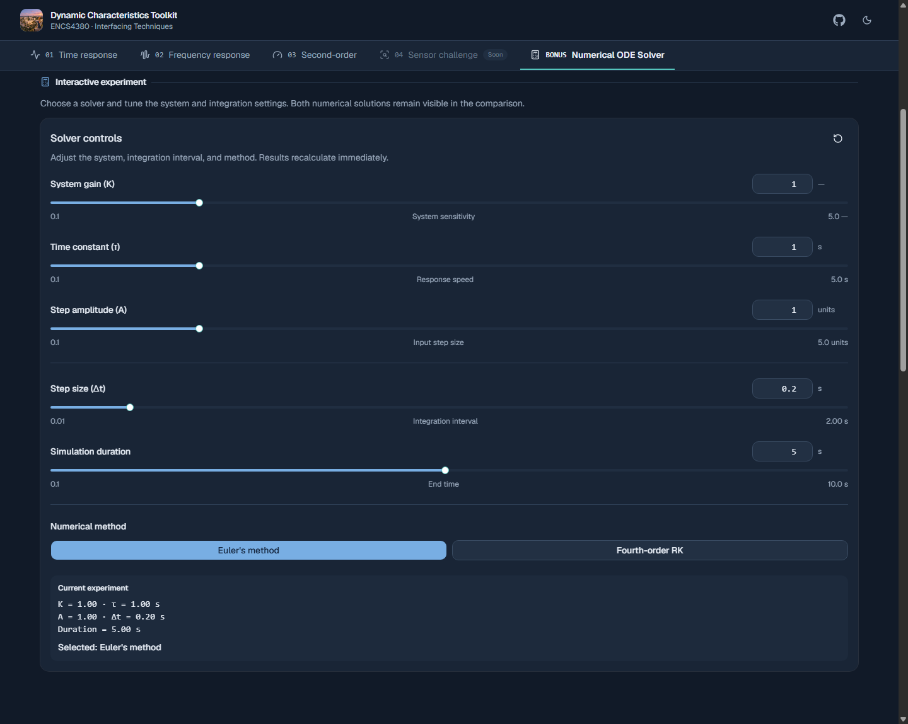

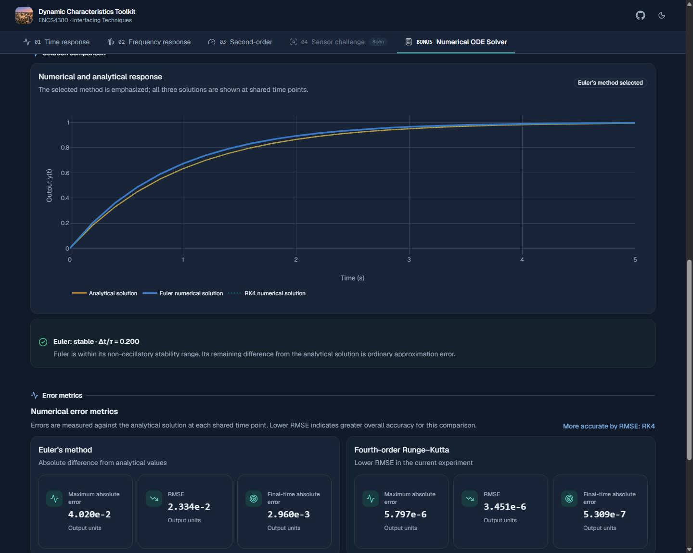

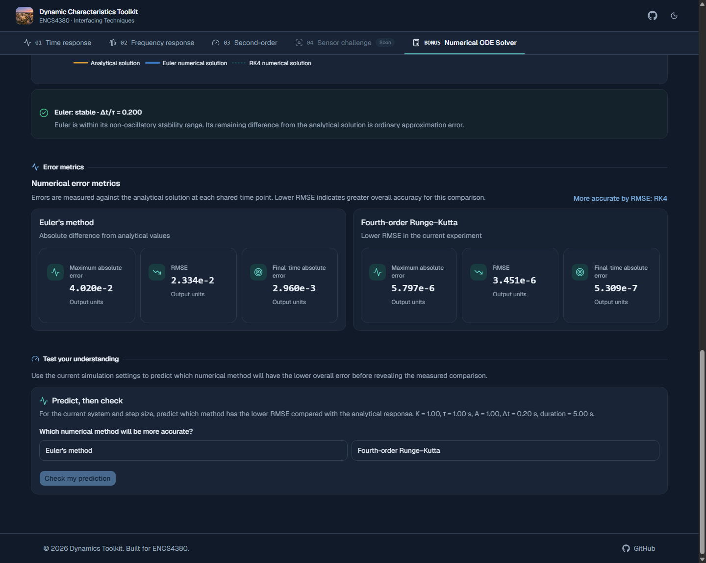

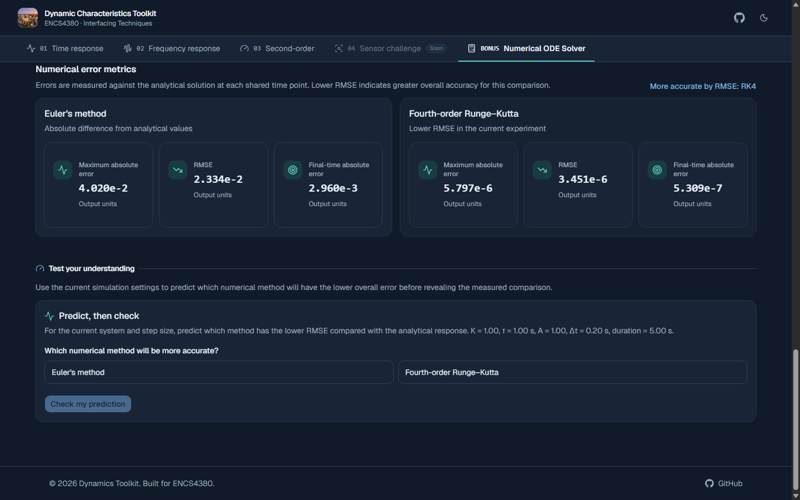

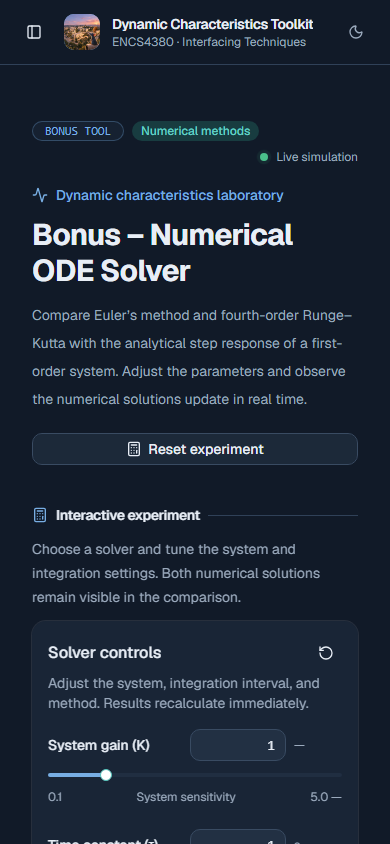

### Digital PID Numerical Validation

The Digital PID module (P3) runs the controller at a sample period \(T_s\) with a zero-order hold; between samples the continuous plant is integrated with the shared RK4 solver (see [Homework 2 — Control Integration](#homework-2--control-integration)). Its validation cases use the first-order plant \(G(s)=1/(s+1)\):

- **P-only** (\(K_p=9,\ K_i=K_d=0\)): closed-loop time constant \(0.1\,s\), unit-step steady-state error \(0.1\), and response \(y(t)=0.9(1-e^{-10t})\).
- **PI** (\(K_p=K_i=1,\ K_d=0\)): characteristic polynomial \(s^2+2s+1\), so \(\omega_n=1\,rad/s\) and \(\zeta=1\). Pole-zero cancellation gives the step response \(y(t)=1-e^{-t}\), with zero limiting error.
- **Integral action:** a stable PI loop with actuator limits wide enough to avoid saturation approaches zero steady-state error.

The response comparisons use \(T_s=0.001\,s\) and allow up to \(0.002\) absolute output error for the P-only case and \(0.0003\) for the PI case. These tolerances bound the difference between the sampled-data loop and the continuous analytical response; larger sample periods change the response physically (see the Nyquist-gain warning in P3). The engine uses \(\lfloor duration/T_s\rfloor\) steps without a shortened final step, so the last sample may precede the requested duration. Saturation is clamped at the actuator limits, with conditional integration preventing windup when saturation and error drive in the same direction.

Run the Digital PID numerical regression tests with:

```bash
npm test
```

To run the Bonus tool locally, start the Vite development server and open `/numerical-ode`:

```bash
npm run dev
```

To check the TypeScript project and produce a production build:

```bash
npm run build
```

---

## Homework 2 — Control Integration

The four PID modules and MySystem live in a **Control** section of the same application, next to the Homework 1 modules.

### Navigation

| Route                        | Page                                                   |
| ---------------------------- | ------------------------------------------------------ |
| `/`                          | Landing page linking Homework 1 and the Control section |
| `/control`                   | Control overview: module cards, shared core, consistency check |
| `/control/pid-playground`    | P1 · PID Playground                                    |
| `/control/slow-sensor-pid`   | P2 · Slow Sensor in the Feedback Loop                  |
| `/control/digital-pid`       | P3 · Digital PID                                       |
| `/control/tuning-challenge`  | P4 · PID Tuning Challenge                              |
| `/control/my-system`         | MySystem                                               |

- **Desktop:** the header switches between *Dynamic characteristics* (HW1) and *Control* (HW2); the bar below lists the modules of the current section.
- **Mobile:** the sidebar groups both sections (the current one opens by default) and lists the page sections.
- Every Control page has a link back to the overview, a "continue" link and a previous/next pager.
- The old top-level URLs (`/pid-playground`, `/digital-pid`, …) redirect to their `/control/…` routes.

### Shared simulation core

All Control modules run on `src/features/control/domain`, which is built from Homework 1 code:

| Piece | File | Reuses |
| ----- | ---- | ------ |
| Plant library | `plants.ts` | Module 1 first-order plant \(K/(\tau s+1)\); Module 3 mass–spring–damper \(1/(ms^2+bs+k)\) and its \(\omega_n,\zeta\) helpers; Module 4 random sensor draw for P4 hidden plants |
| PID law | `pid-law.ts` | One law for every module: derivative on measurement, actuator saturation, conditional anti-windup |
| Continuous loop | `continuous-simulation.ts` | P1, P2 (adds a first-order sensor \(\tau_s\)) and P4 |
| Sampled loop | `digital-simulation.ts` | P3 and MySystem: controller every \(T_s\), zero-order hold, plant integrated between samples |
| ODE solver | `src/lib/numerics/ode.ts` | The Module 7 Euler/RK4 step generalised to state vectors; Module 7 now calls the same code |
| Metrics | `metrics.ts` | One rise/overshoot/settling/\(e_{ss}\) calculation using the Module 3 10–90 % and ±2 % constants; P4 measures against the setpoint for its spec |

Shared UI components (`src/features/control/components`) replace the duplicated plant selector, PID gain sliders, response charts and metrics card in P1–P3 and MySystem.

### Consistency checks

`npm test` runs `src/features/control/domain/control.test.ts` alongside the P3 validation tests. It checks:

- P-only and PD closed loops against the Module 1 and Module 3 analytic step responses (error < 10⁻⁶).
- Sampled metrics against the Module 3 analytic rise time, overshoot, peak time and settling time.
- P2 → P1 as \(\tau_s \to 0\), and P3 → P1 as \(T_s \to 0\).
- P4 plants against the Module 4 sensor responses.
- Anti-windup that behaves the same in the continuous and sampled loops.
- The Nyquist-frequency instability of a sampled derivative on a first-order plant.

The Control overview page runs the same plant and gains through the P1, P2 and P3 engines live in the browser.

### Responsive design and deployment

- Pages use the full phone width (the layout no longer adds a second gutter); plots drop the Plotly toolbar on touch screens and keep their axis labels via automatic margins; block diagrams scroll horizontally instead of shrinking.
- Verified at 375 px (phone), 768 px (tablet), 1024 px (laptop) and 1440 px (desktop) with no horizontal page overflow on any route.
- Everything runs in the browser. `tuning_challenge_backend.py` is a stand-alone discussion script and is not used by the site. The GitHub Pages build and SPA fallback are unchanged.

### Integration screenshots

| Desktop | Mobile |
| ------- | ------ |
| 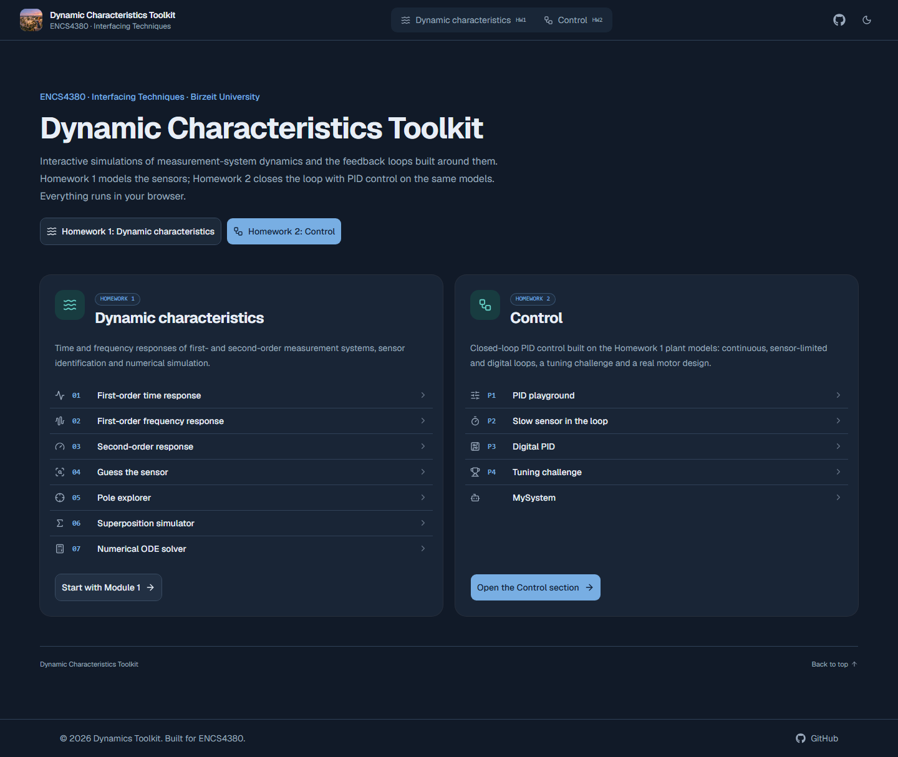 | 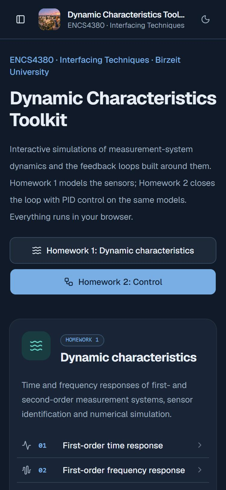 |
| 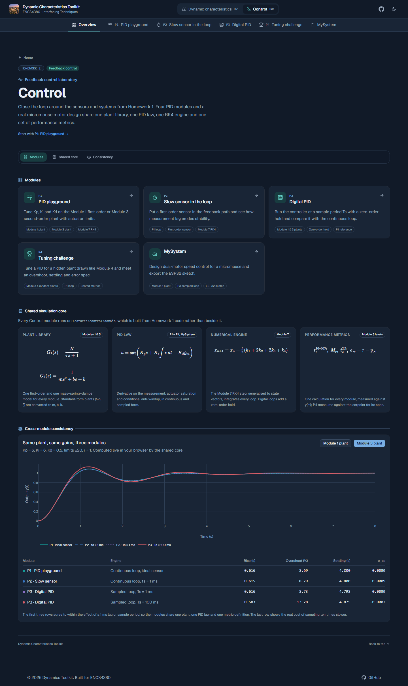 | 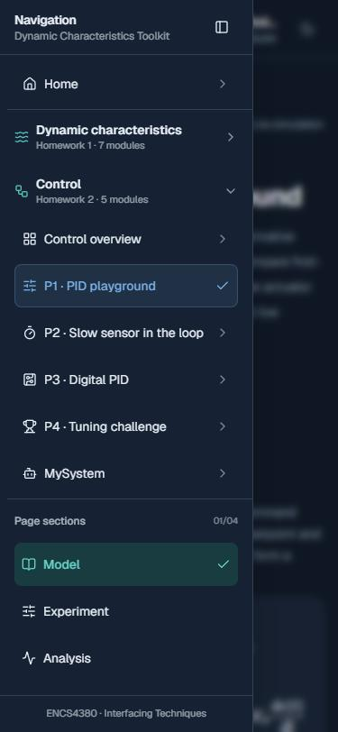 |
| 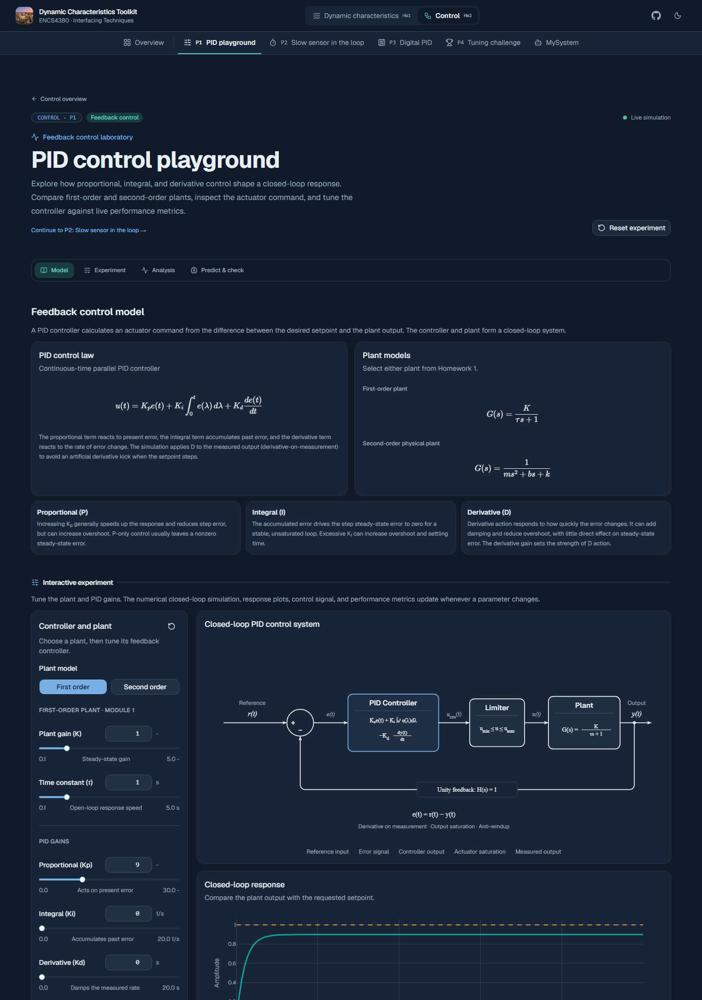 | 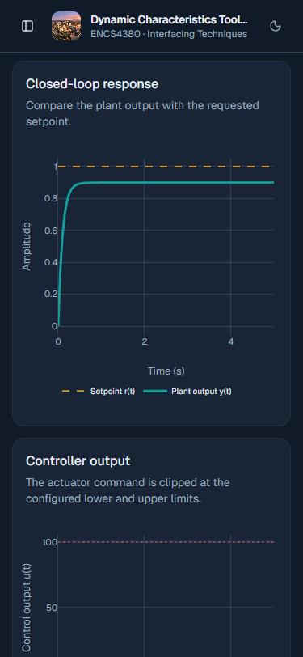 |
| 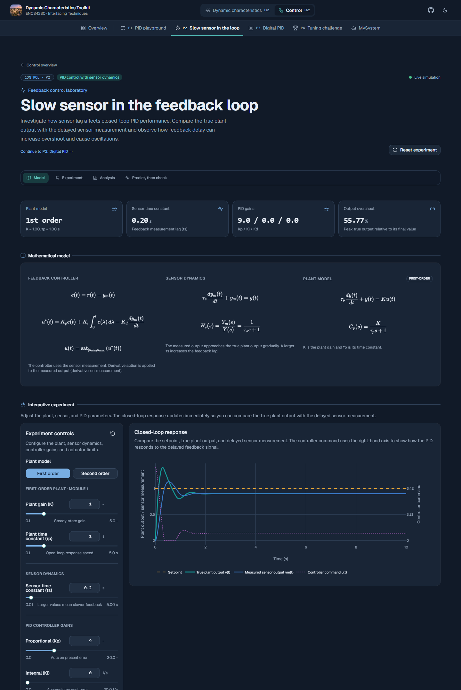 | 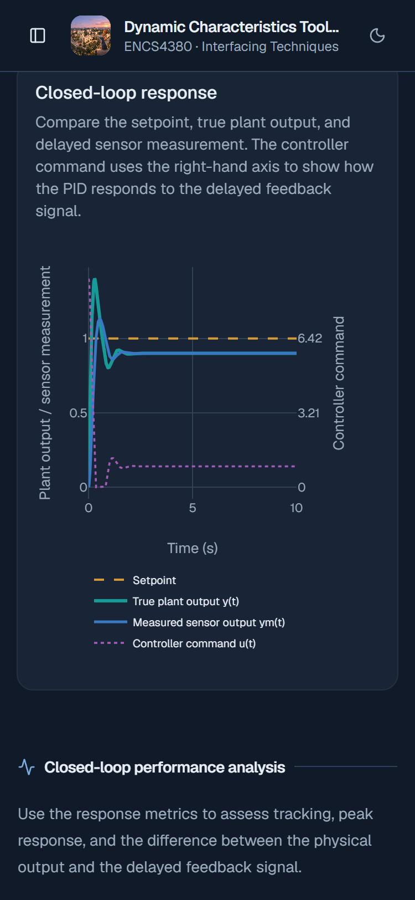 |
| 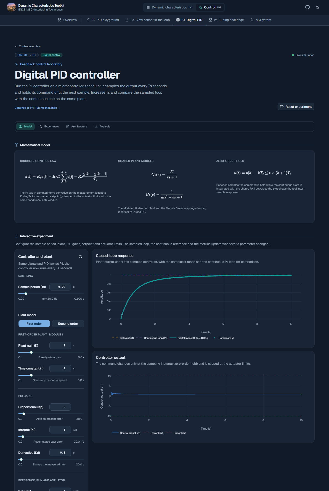 | 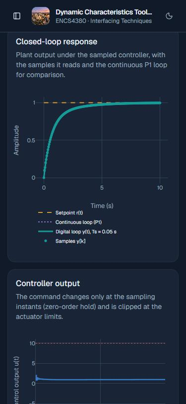 |
| 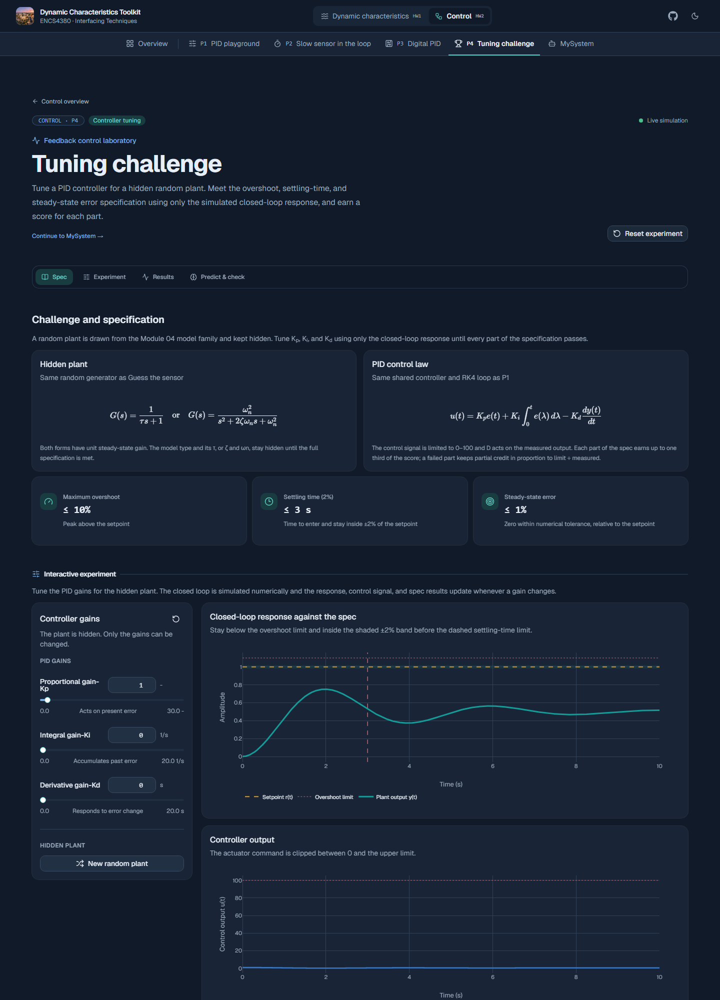 | 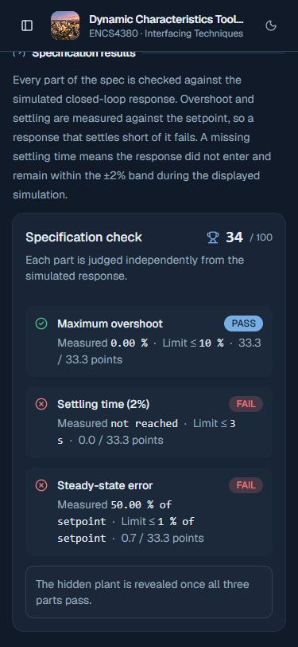 |
| 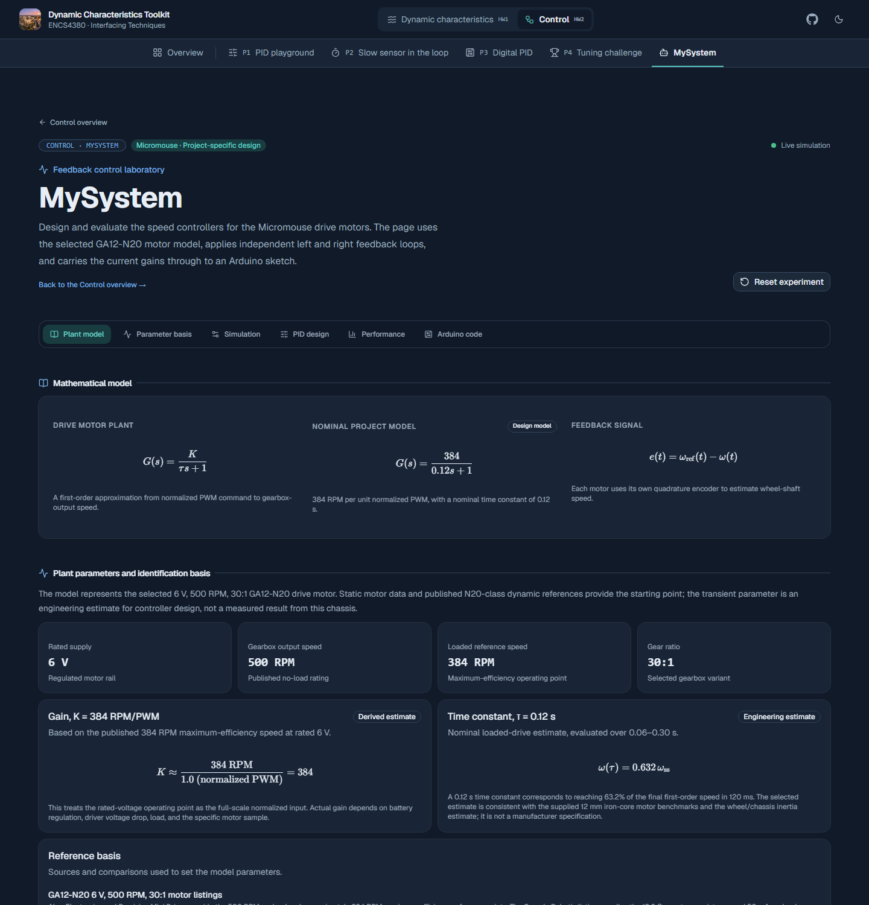 | 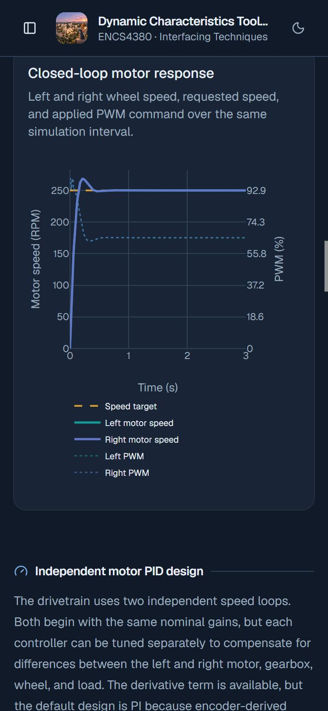 |
| 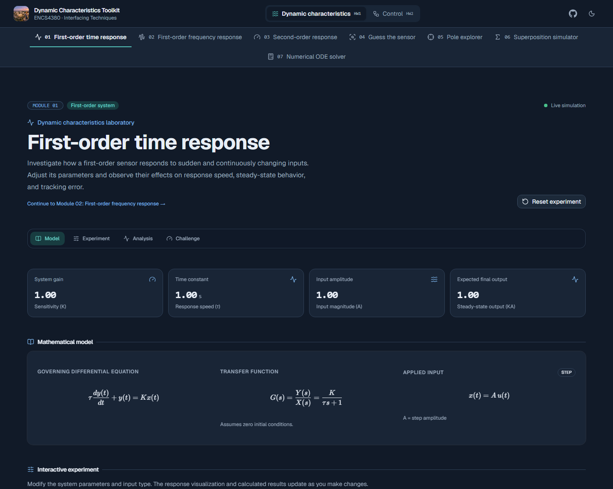 | 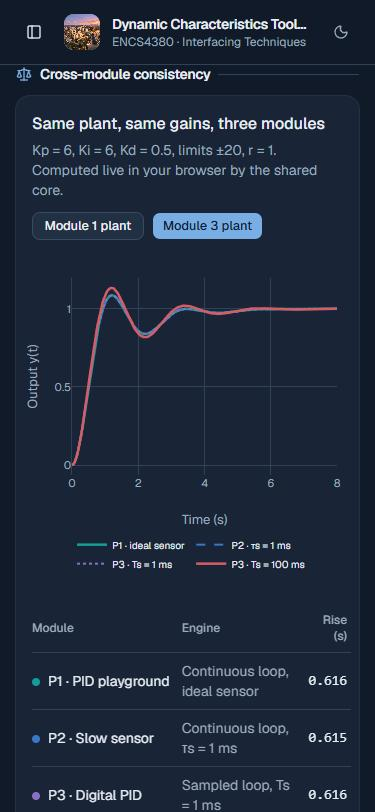 |

---

## Teaching Approach - Predict, Then Check

The toolkit is designed around active exploration. Rather than presenting system responses as static results, it encourages students to form predictions, manipulate system parameters, and compare their expectations with the resulting mathematical calculations and visualizations.

The following prompts connect the theoretical concepts to the interactive experiments:

1. **Time constant:** Predict the percentage of the final value reached by a first-order system after one time constant. Verify the 63.2% response point.
2. **Settling behavior:** Predict the percentage of the final value reached after three time constants. Compare your prediction with the 95% response marker.
3. **Response speed:** Double the time constant while keeping the gain unchanged. Predict how the step response changes.
4. **Ramp tracking:** Predict whether a first-order system can perfectly track a ramp input and determine its steady-state tracking error.
5. **Time lag:** Increase the time constant and predict how the equivalent time lag changes.
6. **Amplitude response:** For \(\tau=0.2\,s\) and an input frequency of \(2\,rad/s\), predict the output-to-input amplitude ratio.
7. **Phase response:** Under the same conditions, predict the phase lag between the input and output.
8. **Cutoff frequency:** Predict how the cutoff frequency changes when the time constant increases.
9. **Damping behavior:** Reduce the damping ratio below one. Predict the resulting overshoot and oscillatory behavior.
10. **Sensor identification:** Given an unknown response curve, identify the characteristics that distinguish first-order from second-order system behavior.

---

## Technology Stack

The toolkit uses a modular React architecture, combining mathematical computation, interactive visualization, and reusable interface components.

| Technology                 | Purpose                                 |
| -------------------------- | --------------------------------------- |
| React                      | Component-based user interface          |
| TypeScript                 | Type-safe application logic             |
| Vite                       | Development server and production build |
| Tailwind CSS               | Responsive styling and design system    |
| shadcn-style components    | Consistent, reusable interface elements |
| Plotly                     | Interactive engineering visualizations  |
| KaTeX                      | Mathematical equation rendering         |
| React Router               | Client-side navigation                  |
| Lucide React / React Icons | Interface iconography                   |

## Architecture and Development

The application follows a consistent frontend architecture across all four modules. Shared interface components, navigation, styling conventions, and visualization patterns provide a unified experience, while each module maintains its own domain-specific calculations and interactions.

Module 1 established the initial interactive structure and visual conventions. Module 2's existing Python implementation was subsequently integrated into the web application using the same overall structure, preserving consistency across the toolkit. The remaining modules extend the application to second-order system analysis and practical parameter estimation.

The implementation emphasizes:

- Separation of module-specific logic and shared interface components.
- Reusable interactive controls and visualization patterns.
- Responsive layouts for desktop and mobile devices.
- Mathematical consistency with the course lecture material.
- Immediate visual feedback when parameters change.

---

## AI-Assisted Development

AI coding assistants were used as development tools throughout the project. Their role was to support technical reasoning, implementation, code review, and interface refinement. All team members remain responsible for understanding and explaining their respective implementations.
# Amjad Adi — Modules

## 1. First-Order Time Response Module

**AI tool**

ChatGPT (OpenAI)

**What I asked**

I asked ChatGPT to help me develop an interactive first-order system module based on the differential equation:

$tau \frac{dy(t)}{dt}+y(t)=Kx(t)$

I provided the module requirements, including:
- Implementing the first-order transfer function and allowing users to adjust the system gain \(K\) and time constant \(\tau\).
- Supporting step and ramp input signals, with the output response updating dynamically when parameters or input types change.
- Displaying the step response and identifying the 63.2% and 95% response points at \(t=\tau\) and \(t=3\tau\), respectively.
- Demonstrating ramp tracking error and its relationship with the time constant.
- Implementing a logarithmic error-fraction plot to illustrate exponential error decay and the relationship between its slope and \(-1/\tau\).
- Including equations, parameter explanations, and an interactive activity where users predict the system response before observing it.

**What I learned**

- How the gain \(K\) determines the steady-state output level, while the time constant \(\tau\) determines the speed of the response.
- Why a first-order system reaches approximately 63.2% of its final value after one time constant and 95% after three time constants.
- How a first-order system responds to a ramp input and why, for a unity-gain system, its steady-state tracking error is \(e_{ss}=A\tau\).
- How the remaining step-response error decays exponentially and how plotting its logarithm produces a straight line with slope \(-1/\tau\).
- How to connect the mathematical model and its analytical solutions to interactive time-domain visualizations.

**How I used it**

I provided the mathematical model, expected analytical relationships, and functional requirements, then used ChatGPT to help translate them into implementation steps and interactive visualizations. I reviewed the proposed equations and response behavior against the first-order system model and used the assistance to guide the implementation within the existing React, TypeScript, Tailwind CSS, and Plotly-based project architecture. I remained responsible for reviewing the implementation and checking that the displayed responses and calculated values were consistent with the mathematical model.

## 2. Pole Explorer

**AI tool:** ChatGPT (GPT-6)

**What I asked:**

I used ChatGPT to support the development of the interactive Pole Explorer, particularly the mathematical calculations, pole manipulation logic, and visualization of the relationship between pole locations and system dynamics.

I provided the technical requirements and specified how the module should integrate into the existing application, including its interactive complex s-plane, time-domain response plots, mathematical equations, and dynamic characteristics.

My prompts covered:

- Translating first-order and second-order system pole locations into their corresponding mathematical models.
- Calculating the damping ratio and natural frequency from complex pole locations.
- Maintaining the complex conjugate relationship when manipulating second-order system poles.
- Implementing the relationship between pole locations, stability, damping, and transient response.
- Calculating percentage overshoot, peak time, and settling time.
- Demonstrating underdamped, critically damped, overdamped, and unstable systems.
- Updating the system parameters and response plots immediately following pole manipulation.
- Refining the interactive s-plane, mathematical presentation, and visualization layout.

**What I learned:**

- How pole locations determine the stability and dynamic characteristics of a system.
- How damping ratio and natural frequency can be derived from complex conjugate poles.
- How the location of poles relative to the imaginary axis affects the speed of the system response.
- How to connect complex-domain representations with time-domain system behavior.
- How to implement interactive mathematical visualizations while maintaining consistency between calculations and plotted responses.

**How I used it:**

I provided the mathematical and functional requirements and guided the implementation toward the intended interactive experience. My understanding of control systems and frontend development allowed me to evaluate the generated calculations, review the relationship between the pole locations and the resulting responses, and request corrections where necessary.

I used AI-generated assistance selectively, reviewing and adapting the implementation and checking that the displayed system characteristics remained consistent with the underlying mathematical relationships.

---

## 3. PID Controller Playground

**AI tool:** ChatGPT (GPT-6)

**What I asked:**

I used ChatGPT to support the development of the interactive PID Controller Playground, focusing on the closed-loop simulation, numerical calculations, controller behavior, and visualization of the system response.

I provided the requirements for implementing a configurable PID controller connected to first-order and second-order plant models. I also specified the required interactive controls, performance metrics, block diagram, and separate visualizations for the system output and controller signal.

My prompts covered:

- Translating the PID control equation into a numerical simulation.
- Implementing the proportional, integral, and derivative terms.
- Connecting the PID controller to the available first-order and second-order plant models.
- Implementing Euler or Runge-Kutta numerical integration for the closed-loop response.
- Allowing interactive adjustment of controller gains, setpoint amplitude, and output limits.
- Calculating rise time, percentage overshoot, settling time, and steady-state error.
- Visualizing the reference input, system output, and controller output.
- Implementing actuator saturation and demonstrating its effect on controller behavior.
- Validating the simulation using the expected P-only and PI responses for the first-order plant with $K=1$ and $\tau=1$.
- Refining the mathematical explanations, block diagram, and interactive learning activity.

**What I learned:**

- How proportional, integral, and derivative actions influence closed-loop system behavior.
- How controller gains affect rise time, overshoot, settling time, and steady-state error.
- How numerical integration can be used to simulate a feedback control system.
- How actuator saturation affects the controller output and closed-loop response.
- How to evaluate controller performance using standard transient and steady-state metrics.
- How to validate a numerical simulation against analytically expected results.

**How I used it:**

I directed the implementation by defining the supported plant models, controller functionality, numerical simulation requirements, and expected validation cases. My control systems knowledge allowed me to evaluate the mathematical implementation, examine the simulated responses, and identify inconsistencies between the expected and displayed behavior.

I also reviewed the component structure and visualization approach to ensure that the new module followed the existing application's design conventions. I treated AI-generated code as implementation assistance, reviewing and adapting it rather than accepting generated solutions without evaluation.

---

## 4. MySystem — Project-Specific PID Design and Simulation

**AI tool:** ChatGPT (GPT-6)

**What I asked:**

I used ChatGPT to support the development of a dedicated MySystem page that applies PID control concepts to our actual Micromouse drive motor system.

Unlike the general-purpose PID Playground, this issue required a project-specific plant model, controller configuration, performance requirements, and generated Arduino code corresponding to the selected hardware.

I provided the project hardware specifications, including the ESP32-S3, GA12-N20 6 V 500 RPM geared motors with Hall encoders, TB6612FNG motor driver, regulated 6 V motor supply, and Pololu wheels.

My prompts covered:

- Identifying suitable plant parameters for the selected GA12-N20 motor using available technical references and published specifications.
- Establishing the first-order transfer function and documenting the basis and limitations of its parameters.
- Evaluating published motor characteristics and comparative system-identification references to establish an engineering estimate for the motor time constant.
- Deriving the initial PI controller gains using the selected damping ratio and natural frequency.
- Determining an appropriate controller architecture for the two drive motors, including the use of independent left and right PID controllers.
- Defining project-specific performance requirements, including the practical damping ratio range of $0.6 \leq \zeta \leq 0.8$.
- Accounting for the motor driver's PWM limitations and controller output saturation.
- Integrating the project-specific plant into the existing PID simulation engine.
- Generating Arduino-compatible PID code using the selected controller configuration.
- Ensuring consistency between the simulated controller and the generated firmware, including controller sampling, output saturation, and anti-windup behavior.
- Integrating the new page into the existing application while reusing its components, mathematical presentation, charts, and interface conventions.
- Refining the page presentation, technical explanations, parameter sources, and generated code display.

**What I learned:**

- How to apply first-order plant modeling to an actual electromechanical system.
- How motor specifications and engineering estimates can be used to establish a preliminary plant model when direct experimental measurements are unavailable.
- How plant gain and time constant influence PID controller design.
- How damping ratio and natural frequency can be used to derive initial PI controller gains.
- Why independent motor-speed controllers are useful for a differential-drive robot.
- How actuator saturation and anti-windup must be considered when translating a simulated controller into embedded firmware.
- How to connect a control-system simulation with an Arduino-compatible implementation.
- How to distinguish published specifications, derived parameters, and engineering assumptions when documenting a project-specific model.

**How I used it:**

I provided the actual project hardware configuration and directed the development toward a controller that could eventually be implemented on our Micromouse robot. I used ChatGPT to investigate available technical references, evaluate possible plant parameters, derive the initial controller configuration, and support the integration of the simulation and firmware generation.

I made the main engineering decisions, including the selected motor configuration, regulated supply voltage, plant model assumptions, controller performance targets, and independent left/right control architecture. I also specified that the implementation should reuse the existing application's components and maintain consistency with its established interface.

I reviewed the generated calculations, controller configuration, simulation behavior, and Arduino code to ensure that they represented the same control-system design. Since direct motor measurements were unavailable, I retained the estimated plant parameters as engineering assumptions rather than presenting them as experimentally measured results.

As with the other modules, I used AI-generated assistance selectively, evaluating and adapting the resulting implementation according to the project's requirements rather than relying on generated code without review.

### Yazeed - Module 2

**AI tool:** [Tool and model]

**What I asked:** [Describe the actual prompts and technical assistance used.]

**What I learned:** [Describe the concepts and implementation knowledge gained.]

**How I used it:** [Describe how the assistance contributed to the completed module.]

### Hanan — Module 3

**AI tool:** ChatGPT (GPT-6) and an AI coding assistant integrated into WebStorm

**What I asked:** I used AI assistance throughout the development of Module 3. I provided the project requirements and asked for help planning the implementation, following the existing Module 1 and Module 2 architecture, and organizing the code into domain logic, controls, pages, and charts.

I also requested assistance with:

Implementing second-order system equations, damping regimes, step responses, response metrics, poles, and state-space calculations.

Designing interactive visualizations for step response, the complex s-plane, and phase-plane trajectories using Plotly.

Connecting physical parameters (mass, damping, and stiffness) to live calculations and visualizations.

Implementing a "Predict, then check" interactive exercise.

Reviewing the implementation against the assignment requirements, identifying missing features, and fixing issues.

Testing numerical accuracy, validating eigenvalues against transfer-function poles, and checking the production build.

**What I learned:** I improved my understanding of second-order dynamic systems, including the relationship between mass, damping, stiffness, natural frequency, and damping ratio. I learned how underdamped, critically damped, overdamped, and undamped systems behave differently.

I also gained practical knowledge of calculating step-response characteristics such as rise time, peak time, percentage overshoot, and settling time. Additionally, I strengthened my understanding of transfer-function poles, state-space representation, eigenvalues, and phase-plane trajectories.

From the software engineering perspective, I learned how to structure a React and TypeScript feature, separate domain calculations from UI components, connect state to interactive charts, validate numerical results, and integrate a new module into an existing application.

**How I used it:** I used AI as a development and review assistant while remaining involved in the implementation decisions and testing process.

I first used it to break the requirements into manageable implementation phases and establish a structure consistent with the existing modules. I then used an AI coding assistant to help implement the domain calculations, interactive controls, charts, state-space analysis, and prediction exercise.

After implementation, I reviewed the generated code and used AI assistance to identify and fix issues found during the requirements audit. I also tested the application by changing the physical parameters and observing how the response curves, damping regime, metrics, and pole locations changed.

Finally, I verified the numerical benchmark results, checked the prediction interaction, ran the TypeScript and production build checks, and used Git to commit and push the completed changes.

### Rahaf — Module 4: Sensor Challenge

**AI tool:**
ChatGPT (GPT-6) and GitHub Copilot.

**What I asked:**
I used ChatGPT to understand the Module 4 requirements, plan the implementation, and prepare technical prompts for GitHub Copilot. I asked for assistance with designing the sensor identification challenge, generating hidden first-order and second-order sensor parameters, adding measurement noise, calculating parameter estimates, and implementing the scoring and feedback system. I also used AI assistance to troubleshoot TypeScript build errors and integrate the module into the existing project structure.

**What I learned:**
I learned how to identify first-order system parameters using the 63.2% response method and how to estimate second-order system parameters using percentage overshoot and peak time. I also improved my understanding of noisy sensor measurements, parameter estimation, error calculation, and comparing estimated values with actual system parameters. Additionally, I learned about React component integration, TypeScript error handling, and Git workflows.

**How I used it:**
I used AI assistance to plan and implement the Sensor Challenge module within the existing React and TypeScript project. GitHub Copilot helped generate the implementation, including random sensor generation, noisy response visualization, parameter input fields, answer validation, accuracy calculations, hints, and score tracking. ChatGPT helped review the implementation process, resolve integration issues, and guide the build and testing steps. I then ran the project locally and successfully completed the production build.

### Bonus Numerical ODE Solver

An AI coding assistant supported the development process for this standalone feature through planning, implementation assistance, code review, debugging, and verification. This included help examining the feature requirements and integration points, reasoning about and implementing the user-interface code, reviewing the changes, investigating issues, and checking numerical behavior, routes, and the production build. AI assistance contributed to code and technical decisions; it is not represented as work independently written by the student. The project team remains responsible for reviewing, understanding, and validating the submitted work.

## Validation

The toolkit is evaluated against the numerical validation cases supplied in the homework specification.

| #   | Validation case                                                | Expected result                                   |
| --- | -------------------------------------------------------------- | ------------------------------------------------- |
| 1   | First-order step response at \(t=\tau\)                        | \(y(\tau)=0.632KA\)                               |
| 2   | First-order step response at \(t=3\tau\)                       | \(y(3\tau)=0.95KA\)                               |
| 3   | Frequency response, \(\tau=0.2\,s\), \(\omega=2\,rad/s\)       | \(M\approx0.93\), phase lag \(\approx21.8^\circ\) |
| 4   | Maximum time constant for 100 Hz signals with 5% dynamic error | \(\tau_{\max}\approx0.52\,ms\)                    |
| 5   | Phase lag at 50 Hz using the maximum time constant             | \(\approx9.3^\circ\)                              |
| 6   | Second-order response with \(\zeta=0.5\)                       | Overshoot \(\approx16.3\%\)                       |
| 7   | Second-order response with \(\zeta=1\)                         | No overshoot                                      |
| 8   | State-space model, \(m=1,\ b=2,\ k=4\)                         | Eigenvalues \(-1\pm j1.732\), matching the poles  |

The validation results are presented within the relevant modules, allowing users to compare expected values with the application's calculated results.

---

## GitHub Contributions

**Repository:** [encs4380-dynamics-Remy](https://github.com/Amjad-Adi/encs4380-dynamics-Remy)

The project is maintained in a shared public repository. Each member contributes through their own GitHub account, maintaining a traceable development history.

| Team Member | GitHub Username | Contribution History  |
| ----------- | --------------- | --------------------- |
| Amjad Adi   | [Username]      | [Commit history link] |
| Yazeed      | [Username]      | [Commit history link] |
| Rahaf       | [Username]      | [Commit history link] |
| Hanan       | [Username]      | [Commit history link] |

Each module is tracked through a dedicated GitHub Issue assigned to its responsible member. Commits document implementation, refinements, bug fixes, and integration work.

## Screenshots

The project screenshots are maintained in the repository's `screenshots/` directory.

```text
screenshots/
├── module-1-step-response.png
├── module-1-ramp-response.png
├── module-1-error-analysis.png
├── module-2-frequency-response.png
├── module-2-bode-analysis.png
├── module-2-dynamic-error.png
├── module-3-main.png
├── module-3-state-space.png
├── module-4-challenge.png
├── module-4-results.png
├── bonus-numerical-ode-controls.png
├── bonus-numerical-ode-comparison.png
├── bonus-numerical-ode-errors.png
├── bonus-numerical-ode-prediction.png
└── bonus-numerical-ode-mobile.png
```

The screenshots above are referenced directly in the corresponding module sections.

---

## Running Locally

```bash
git clone https://github.com/Amjad-Adi/encs4380-dynamics-Remy.git

cd encs4380-dynamics-Remy

npm install

npm run dev
```

To generate a production build:

```bash
npm run build
```

## Deployment

The application is deployed as a static website through GitHub Pages. GitHub Actions automates the production build and deployment process whenever changes are pushed to the `main` branch.

**Live application:** https://amjad-adi.github.io/encs4380-dynamics-Remy/

## Academic Information

**Course:** ENCS4380 – Interfacing Techniques  
**University:** Birzeit University  
**Instructor:** Dr. Wasel Ghanem  
**Assignment:** Homework 1 – Dynamic Characteristics Interactive Toolkit  
**Released:** Thursday, 29 October 2026  
**Due:** Thursday, 12 November 2026  
**Final release:** v1.0
